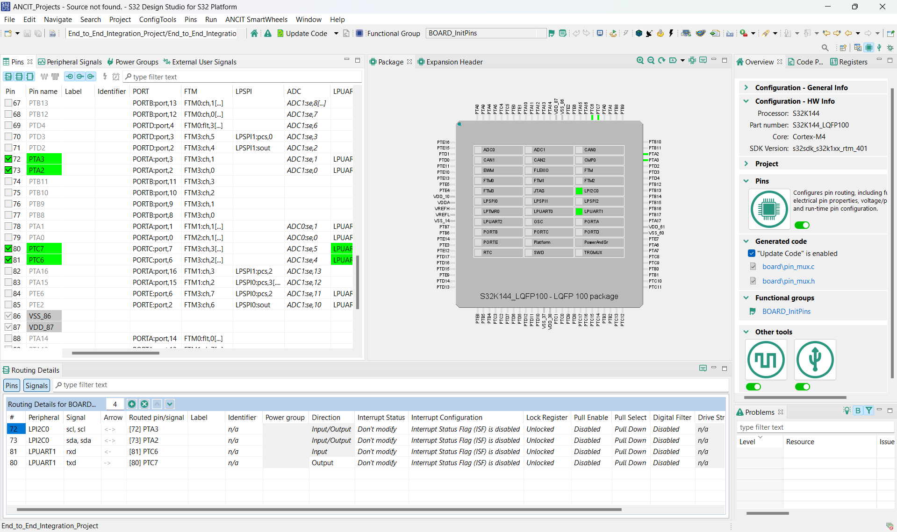
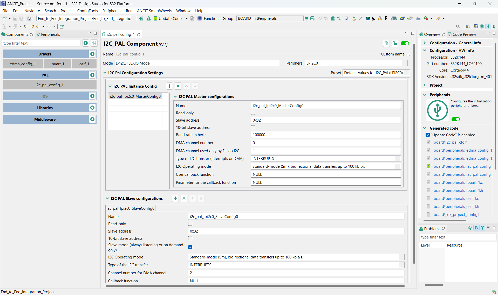
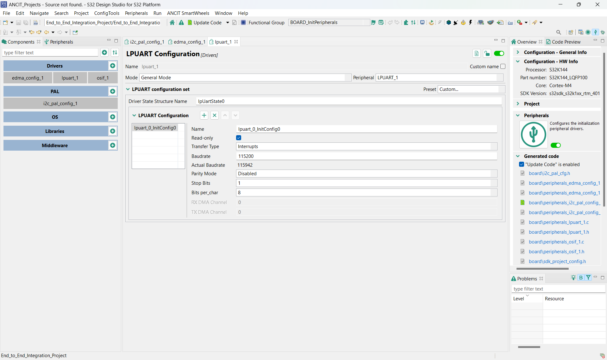
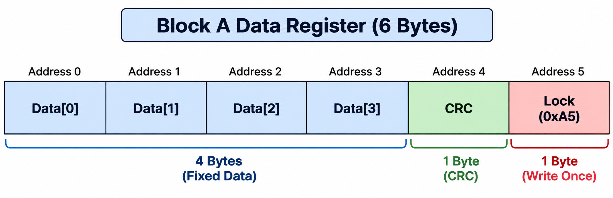
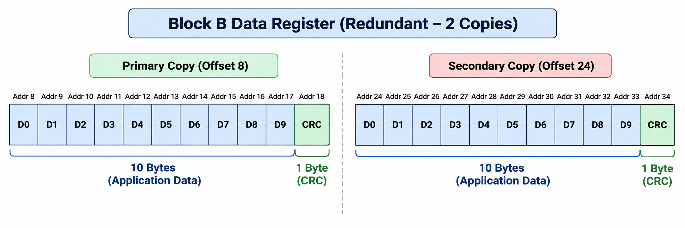
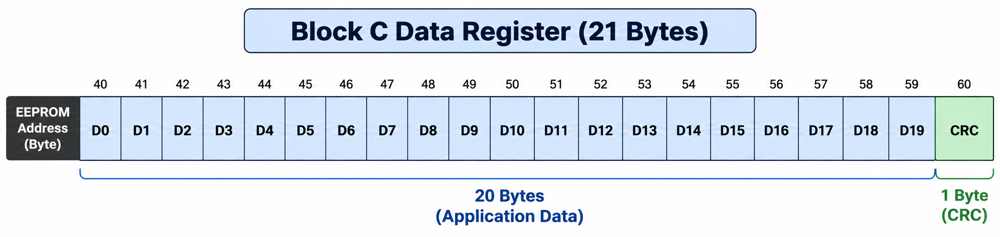
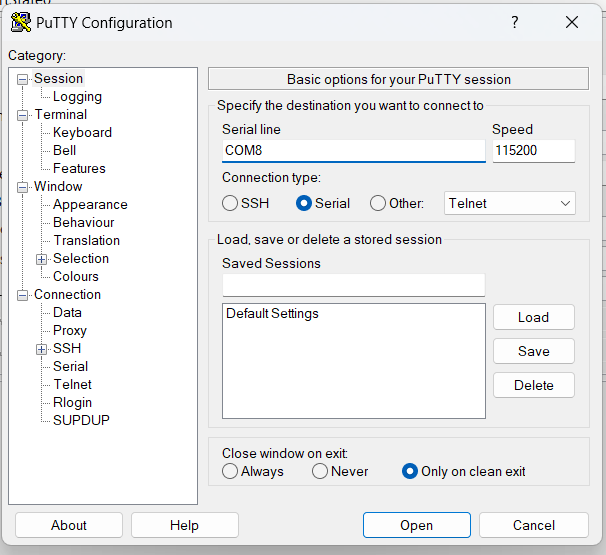
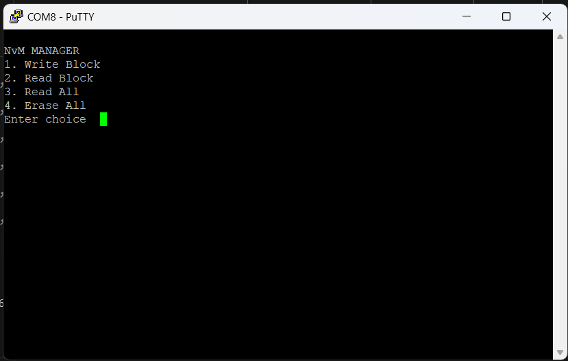
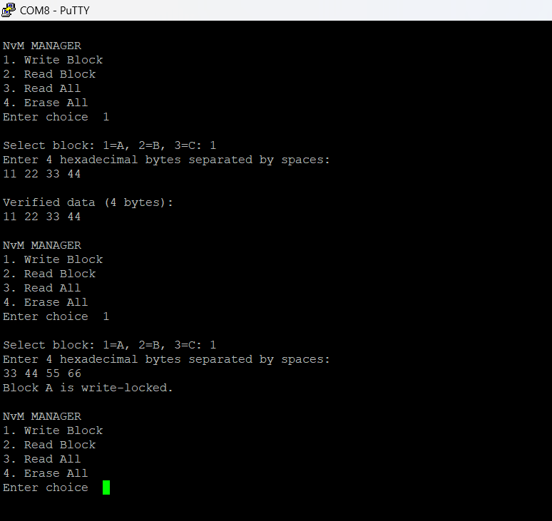
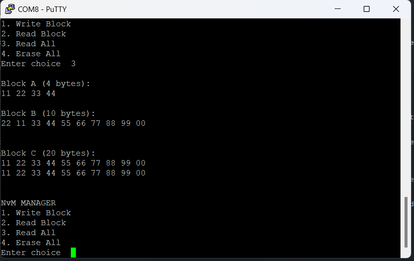

# End to End Integration – EEPROM and NvM Manager

## 1. Problem Analysis

The objective of this exercise is to integrate three different non-volatile memory (NvM) blocks into a single application using the S32K144 microcontroller and an external 24C04 EEPROM.

Each block has different storage requirements. Block A must support write-once protection, fixed RAM storage, and CRC-based data validation. Block B must support redundant storage using two EEPROM copies and flexible RAM access. Block C must support multi-page data storage without write protection and must be erasable.

The main challenge is to combine all three blocks without overlapping their EEPROM memory locations, include the CRC bytes in the memory calculation, and ensure that the complete allocation remains within the EEPROM's 512-byte capacity.

Finally, the application must execute `NvM_EraseAll()` followed by `NvM_ReadAll()` to verify that erased or invalid data is handled correctly and that each block returns its configured default/fallback values.

### Objectives

- Integrate Blocks A, B, and C into a single NvM manager.
- Implement CRC-based data integrity verification.
- Implement write-once protection for Block A.
- Provide redundant storage for Block B.
- Support multi-page read/write operations for Block C.
- Verify EEPROM memory allocation, including CRC and redundant-copy overhead, against the 512-byte limit.
- Verify erase and recovery behaviour using `NvM_EraseAll()` and `NvM_ReadAll()`.

## 2. Hardware and Software Requirements

### Hardware

- NXP S32K144 microcontroller development board (EV2).
- External 24C04 EEPROM with 512 bytes of storage.
- I2C connections between the microcontroller and EEPROM.
- USB connection for programming and UART communication with a PC.

### Software

- S32 Design Studio (S32DS).
- S32 SDK RTM 4.0.1.
- I2C Peripheral Abstraction Layer (PAL).
- LPUART driver for serial communication.
- PuTTY or a similar serial terminal for monitoring and testing.

> **Screenshot note:** Images in this README use repository-relative paths under `Screenshots/`. Upload the matching PNG files to that folder in GitHub so they are visible to everyone.

## 3. Pin Configuration

The application uses I2C to communicate with the EEPROM and UART to interact with the user.

| S32K144 pin | Peripheral | Function |
|---|---|---|
| PTA2 | LPI2C0_SDA | I2C serial data |
| PTA3 | LPI2C0_SCL | I2C serial clock |
| PTC6 | LPUART1_RX | UART data reception |
| PTC7 | LPUART1_TX | UART data transmission |

### I2C Configuration

- **I2C instance:** LPI2C0
- **EEPROM address:** `0x50` for the lower 256-byte section, with the upper address bit selected for the second section.
- **Communication speed:** 100 kHz.
- **EEPROM capacity:** 512 bytes.
- **Page size:** 8 bytes.

The EEPROM uses I2C for reading and writing stored data. The driver selects the appropriate 256-byte section using the high address bit and uses the lower address byte to specify the location within that section.

### UART Configuration

LPUART1 provides the user interface through a serial terminal. It displays the NvM menu, accepts block selections and hexadecimal input, and prints the contents of each memory block.

## 4. Block Integration and Memory Allocation

### Block A – Write-Once, Fixed RAM and CRC

Block A stores 4 bytes of application data and an additional CRC byte for integrity verification.

- EEPROM offset: `0`
- Data size: 4 bytes
- CRC size: 1 byte
- Total storage: 5 bytes
- Write-once lock address: `5`
- Lock value: `0xA5`

Once Block A has been successfully written and its lock marker is stored, subsequent write attempts are rejected. CRC validation is performed when reading the data.

### Block B – Redundant Storage and Flexible RAM

Block B stores 10 bytes of application data along with a CRC byte. Two copies are maintained to provide redundancy.

| Parameter | Primary copy | Secondary copy |
|---|---:|---:|
| EEPROM offset | 8 | 24 |
| Data size | 10 bytes | 10 bytes |
| CRC overhead | 1 byte | 1 byte |
| Total storage | 11 bytes | 11 bytes |

When reading Block B, the manager first validates the primary copy. If the primary copy is invalid, the secondary copy is read and validated as a fallback.

### Block C – Multi-Page Storage Without Protection

Block C stores 20 bytes of application data and one CRC byte.

- EEPROM offset: `40`
- Data size: 20 bytes
- CRC size: 1 byte
- Total storage: 21 bytes
- Write protection: Disabled

Because the EEPROM page size is 8 bytes, a 21-byte write must be divided into multiple page-compatible operations. This prevents a write from crossing a page boundary in a single page-write transaction.

### EEPROM Footprint Calculation

| Component | Storage required |
|---|---:|
| Block A data and CRC | 5 bytes |
| Block A lock marker | 1 byte |
| Block B primary copy and CRC | 11 bytes |
| Block B secondary copy and CRC | 11 bytes |
| Block C data and CRC | 21 bytes |
| **Total occupied storage** | **49 bytes** |

The highest allocated address is 60, so the allocated address range spans addresses 0–60, or 61 bytes including the unused gaps between blocks.

The actual occupied storage is 49 bytes, which is well within the 512-byte EEPROM capacity.

**Memory verification:** 49 bytes is less than 512 bytes. The memory allocation includes the CRC bytes, the redundant copy of Block B, and the write-once lock marker.

## 5. Function Implementation and Their Roles

The implementation is divided into `NvM.c`, which manages EEPROM operations and block handling, and `main.c`, which manages peripheral initialization, user input, and testing.

### 5.1 EEPROM Communication Functions

**1. `SelectEepromHalf()`**

- **Necessity:** The 24C04 EEPROM has 512 bytes, addressed in two 256-byte sections.
- **Procedure:** Extracts the upper address bit and combines it with the base I2C address to select the required section.
- **Role:** Ensures that read and write operations access the correct EEPROM location.

**2. `EepromWrite()`**

- **Necessity:** EEPROM writes must respect the 8-byte page boundary.
- **Procedure:** Calculates the remaining space in the current page, writes a page-compatible chunk, waits for the write cycle, and repeats until all bytes are written.
- **Role:** Provides reliable page-by-page storage for all three blocks.

**3. `EepromRead()`**

- **Necessity:** Stored data must be retrieved before it can be validated or used.
- **Procedure:** Selects the EEPROM section, transmits the word address, and receives the requested bytes through I2C.
- **Role:** Provides the basic read operation used by the NvM functions.

### 5.2 CRC and Data Validation Functions

**4. `CRC_Calculate()`**

- **Necessity:** Data stored in EEPROM may become corrupted.
- **Procedure:** Processes each data byte using XOR and bit-shifting operations with the CRC polynomial `0x07`.
- **Role:** Generates an 8-bit checksum for detecting data corruption.

**5. `WriteCopy()`**

- **Necessity:** Each stored record must contain both application data and its CRC.
- **Procedure:** Copies the data into a temporary buffer, calculates the CRC, appends it, and writes the complete record using `EepromWrite()`.
- **Role:** Ensures that primary and redundant records are stored with integrity information.

**6. `ReadCopy()`**

- **Necessity:** A successful EEPROM read does not guarantee that the stored data is valid.
- **Procedure:** Reads the data and CRC, recalculates the CRC, and compares it with the stored value.
- **Role:** Accepts records that pass CRC validation and rejects invalid records.

### 5.3 NvM Block Management Functions

**7. `NvM_WriteBlock()`**

- **Necessity:** Each block has different storage requirements, including write protection and redundancy.
- **Procedure:** Checks the Block A lock marker when required, writes the primary record, writes the secondary copy if configured, and sets the lock marker for Block A.
- **Role:** Provides a common write interface for Blocks A, B, and C.

**8. `NvM_ReadBlock()`**

- **Necessity:** The application must retrieve valid data and recover from a corrupted primary copy when redundancy is available.
- **Procedure:** Reads and validates the primary copy. If it fails, attempts the secondary copy when configured.
- **Role:** Provides block-level data retrieval and redundant-copy recovery.

**9. `NvM_ReadAll()`**

- **Necessity:** All configured blocks must be restored to RAM during initialization and after an erase operation.
- **Procedure:** Reads Blocks A, B, and C individually. If a block cannot be validated, its corresponding RAM buffer is filled with zeros using `memset()`.
- **Role:** Loads valid stored data or provides fallback RAM values.

**10. `NvM_EraseAll()`**

- **Necessity:** The integration test requires the entire EEPROM to be erased before checking fallback behaviour.
- **Procedure:** Fills an 8-byte buffer with `0xFF` and writes it repeatedly across the 512-byte address space.
- **Role:** Erases all EEPROM locations, including block records and the write-once lock marker.

### 5.4 UART and User Interface Functions

**11. `UART_Print()`**

- **Necessity:** The user needs feedback about menu options, operations, and errors.
- **Procedure:** Calculates the message length and transmits the string through the configured UART driver.
- **Role:** Displays application messages in the serial terminal.

**12. `UART_PrintBlock()`**

- **Necessity:** Block contents must be displayed clearly during verification.
- **Procedure:** Prints the block name and data length, formats each byte as two-digit hexadecimal, and inserts line breaks for readability.
- **Role:** Displays the contents of an individual RAM buffer.

**13. `PrintAllBlocks()`**

- **Necessity:** The results of an all-block read or erase test must be examined together.
- **Procedure:** Calls `UART_PrintBlock()` for Blocks A, B, and C.
- **Role:** Displays the current RAM contents of all three blocks.

**14. `UART_ReadLine()`**

- **Necessity:** The application needs to accept menu choices and hexadecimal data from the user.
- **Procedure:** Receives characters through UART until Enter is pressed, handles backspace, and stores the input in a bounded buffer.
- **Role:** Provides basic serial-terminal input.

**15. `SelectBlock()`**

- **Necessity:** The same read and write functions must work with different block configurations.
- **Procedure:** Accepts the user's choice and returns the corresponding block configuration and RAM buffer.
- **Role:** Selects Block A, B, or C without duplicating the block-handling logic.

**16. `ReadBlockMenu()`**

- **Necessity:** Users need a way to test an individual block.
- **Procedure:** Selects a block, calls `NvM_ReadBlock()`, and displays the data if the read succeeds.
- **Role:** Provides individual block-read testing.

**17. `WriteBlockMenu()`**

- **Necessity:** Users need to enter test data and verify that it can be stored.
- **Procedure:** Selects a block, converts hexadecimal input into bytes, calls `NvM_WriteBlock()`, and reads the record back for verification.
- **Role:** Provides interactive write testing and readback verification.

**18. `ReadAllMenu()`**

- **Necessity:** All three blocks must be checked in a single operation.
- **Procedure:** Calls `NvM_ReadAll()` and then `PrintAllBlocks()`.
- **Role:** Displays the valid data or fallback values for every block.

**19. `EraseAllMenu()`**

- **Necessity:** The required test sequence is `NvM_EraseAll()` followed by `NvM_ReadAll()`.
- **Procedure:** Erases the EEPROM, reloads all blocks into RAM, and displays their contents.
- **Role:** Verifies that the application handles erased or invalid records using fallback values.

**20. `main()`**

- **Necessity:** The application requires a central entry point to initialize hardware and coordinate all operations.
- **Procedure:** Initializes the clock, pins, UART, and I2C; loads the blocks; and continuously displays the menu and processes user selections.
- **Role:** Coordinates the complete end-to-end integration test.

## 6. Main Program and User Interface

The `main()` function initializes the clock, pin configuration, UART and I2C peripherals. It then calls `NvM_ReadAll()` to load the available data into RAM.

After initialization, the program continuously displays the NvM Manager menu through UART.

| Menu option | Operation |
|---|---|
| 1 | Write a selected block |
| 2 | Read a selected block |
| 3 | Read all three blocks |
| 4 | Erase the EEPROM and read all blocks |

The user selects a block by entering `1`, `2`, or `3`. For write operations, the application accepts hexadecimal bytes, writes them to the selected block, and reads the block back for verification.

For the erase operation, the program calls `NvM_EraseAll()` followed by `NvM_ReadAll()` and prints the contents of all three RAM buffers.

## 7. Testing and Verification Procedure

### Step 1 – Build and Flash

Build the project in S32 Design Studio and flash the generated program onto the S32K144 EV2 board.

### Step 2 – Open the Serial Terminal

Open PuTTY or another serial terminal and configure it to match the LPUART1 settings used in the project. Reset the board and confirm that the NvM Manager menu appears.

### Step 3 – Test Individual Blocks

- Write data to Block A and read it back.
- Attempt another write to Block A and verify that the write-once lock rejects it.
- Write data to Block B and verify that the primary copy can be read.
- Test redundant-copy recovery by deliberately corrupting the primary copy and checking whether the secondary copy is accepted.
- Write and read Block C to verify multi-page operation.

### Step 4 – Verify EEPROM Capacity

Check the configured offsets, data lengths, CRC bytes, redundant storage, and lock-marker location. Confirm that the allocation fits within the 512-byte address space.

### Step 5 – Execute Erase and Recovery

Select menu option `4`. The application executes `NvM_EraseAll()` and then `NvM_ReadAll()`.

After a successful erase, the stored CRC values should no longer validate the erased block records. Consequently, `NvM_ReadAll()` should load the configured zero-filled fallback buffers.

Expected fallback RAM values:

| Block | Fallback value | Length |
|---|---|---:|
| Block A | `00 00 00 00` | 4 bytes |
| Block B | Ten zero bytes | 10 bytes |
| Block C | Twenty zero bytes | 20 bytes |

These are RAM fallback values, not the actual erased EEPROM contents. The erased EEPROM contains `0xFF` bytes.

**Important:** The current `main.c` does not check or print the return status of `NvM_EraseAll()`. For complete verification, check that return status before calling `NvM_ReadAll()` and report any erase failure through UART.

## 8. Expected Outcome

The integrated application demonstrates three different non-volatile storage strategies within one EEPROM manager:

- Write-once protection and CRC validation for Block A.
- Redundant storage and fallback recovery for Block B.
- Multi-page storage without write protection for Block C.

The combined allocation requires only 49 occupied bytes, including CRC overhead and the write-once marker, and therefore fits within the 512-byte EEPROM capacity.

After a successful erase followed by `NvM_ReadAll()`, all three blocks should report their configured zero-filled fallback values. Successful completion of these tests demonstrates the integration of the three blocks and the basic erase-and-recovery workflow.

## 9. Conclusion

The End-to-End Integration exercise combines write protection, CRC-based data integrity, redundant storage, and multi-page EEPROM access into a single NvM manager. By allocating separate EEPROM regions for the three blocks and accounting for all additional storage overhead, the implementation remains within the available memory capacity.

The erase-and-read-all sequence verifies the application's fallback behaviour when valid stored records are unavailable. This exercise provides a practical foundation for understanding non-volatile memory management and data recovery in embedded automotive systems.

## 10. Author

### SIVAARUNMANI G K
Electronics and Communication Engineering · Automotive Embedded Systems

### RAVEENDRANATH K L
Electronics and Communication Engineering · Automotive Embedded Systems

